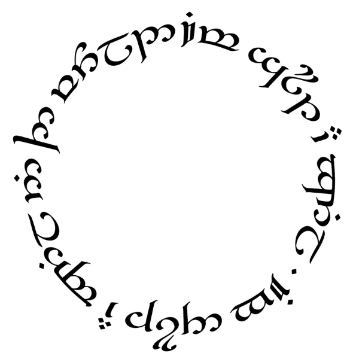

<div align="center">
  
  <h1>One Knob</h1>
  <p><b>One knob. Three flavours. To rule them all.</b><br/>A saturation and distortion plugin by fenrikos · VST3, AU, LV2 and Standalone for Windows, macOS and Linux</p>
</div>

---

<div align="center">
  
</div>

## 🎛️ Overview

**One Knob** (formerly OneKnobToRuleThemAll) is a single-knob saturation and distortion plugin built with JUCE.
Turn the inscribed knob from a sleeping village to a dragon's breath: the drive, filtering and bias all move
together, and the output stays as loud as the input the whole way, so you hear the colour, not just more volume.

## ✨ Key Features

- **One Knob Design**: one control for drive, tone and grit. Double-click it to go back to 0 %.
- **3 Distinct Flavors**:
  - **DWARVEN**: Tape saturation style. Digs too greedily and too deep.
  - **ELVEN**: Smooth analog console overdrive. Elegant and immortal.
  - **DRAGONFIRE**: Total destruction with an asymmetric fold. Leaves nothing standing.
- **Clean at any setting**: 8x oversampling keeps aliasing out, even at full drive.
- **Level-matched**: a measured per-flavour trim keeps the output level with the input across the knob.
- **Click-free**: switching flavours and bypassing both crossfade. Hosts see a proper bypass parameter.
- **Dynamic UI**: the ember glow grows with the drive and breathes with the audio, and the status text
  climbs as you turn the knob.
- **Native everywhere**: VST3 on all platforms, AU on macOS, LV2 on Linux, plus a Standalone app.

## 🛠️ Installation

Download the zip for your system from the [Releases](../../releases) page:
`OneKnob-<version>-Windows-x64.zip`, `OneKnob-<version>-macOS.zip` (universal) or `OneKnob-<version>-Linux-x64.zip`.
Each has a README with the install steps.

- **Windows:** copy `One Knob.vst3` to `C:\Program Files\Common Files\VST3`.
- **macOS:** copy `One Knob.vst3` to `/Library/Audio/Plug-Ins/VST3` and `One Knob.component` to
  `/Library/Audio/Plug-Ins/Components`. The builds are not notarised; the README in the zip has the Terminal
  command that unblocks them.
- **Linux:** run `./install.sh` from the unzipped folder.

Upgrading from OneKnobToRuleThemAll 1.0? One Knob opens your old sessions with the same settings. Delete the
old plugin files so your host doesn't list it twice.

## 💻 Building

One Knob uses **CMake** and **JUCE 8**. JUCE is fetched automatically unless you point the build at a local checkout.

```bash
cmake -B build -DCMAKE_BUILD_TYPE=Release            # optional: -DJUCE_DIR=/path/to/JUCE
cmake --build build --config Release --parallel
```

The plugins end up in `build/OneKnob_artefacts/Release/`. Useful options:

| Option | Default | |
|---|---|---|
| `ONEKNOB_TESTS` | ON | Builds `OneKnobTests`: latency, bypass, level matching, aliasing, click-free switching |
| `ONEKNOB_LTO` | ON | Link-time optimisation; turn off for faster development builds |
| `ONEKNOB_SNAPSHOT` | OFF | Builds `OneKnob_snapshot`, which renders the editor to PNG |
| `ONEKNOB_CALIBRATE` | OFF | Builds `OneKnob_calibrate`, which re-measures the level trim after DSP changes |

### Releasing

The **Build** workflow builds Windows, macOS and Linux, runs the unit tests, pluginval and auval, and packages a zip
per platform. Run it from the Actions tab, or push a `v*` tag to also publish a GitHub Release with the zips and the
matching section of `packaging/CHANGELOG.txt`.

## 📜 Licence

Copyright (C) 2026 fenrikos.

One Knob is free software: you can redistribute it and/or modify it under the terms of the
[GNU Affero General Public License](LICENSE) as published by the Free Software Foundation, either version 3 of the
License, or (at your option) any later version. It is distributed in the hope that it will be useful, but WITHOUT ANY
WARRANTY; without even the implied warranty of MERCHANTABILITY or FITNESS FOR A PARTICULAR PURPOSE.

One Knob uses [JUCE](https://juce.com) under the AGPLv3, the VST 3 SDK (MIT) and LV2 (ISC); see [THIRDPARTY.md](THIRDPARTY.md).

## ☕ Support the Project

One Knob is completely free and open-source. If it finds a place in your mixes, you can
**[support it on Gumroad](https://fenrikos.gumroad.com/l/oneknob)** for whatever you like.
Your support helps keep this project alive and funds future plugins!
